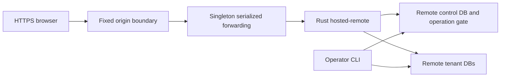

# Design: Cloudflareで招待制ベータを公開する

## Overview
Cloudflare WorkerをHTTPS入口、RustをContainerとし、controlと組織別DBの正本はTurso Cloud libSQLへ置く。既存の画面・認証・業務SQLを再実装しない。独自domainは後から変更でき、初期URLは`meibo-beta.<workers-subdomain>.workers.dev`とする。

## Boundary Commitments
- This Spec Owns: Worker/Container設定、公開Hostの固定、secret受渡し、配備前検査、実行物と公開ゲート、配備・復旧の実環境確認。
- Out of Boundary: SQL adapter・DB識別・組織対応・認証・永続排他・保存形式はremote-storage/team-access。公開signup・課金・外部ログイン・domain購入・他サービスの変更は含めない。
- Allowed Dependencies: Worker→Containerの既存HTTP、Container→remote-storageの`hosted-remote CONFIG COMMAND`。運用CLIも同じremote gateを使う。初期化・復旧は運用者のCLIで行い、公開HTTPへ管理用の迂回入口を追加しない。
- Revalidation Triggers: origin、要求転送、remote CLI/設定/結果不明エラー、CPU形式、image、secret名、DO/Containerの更新方式が変われば公開ゲートを再実行する。

## Architecture

DOの直列化は混雑を減らすためで、保存の正しさはremote-storageの非失効gateが担う。再配備中の重複やCLIも同じgateへ参加する。

## File Structure Plan
| Component | ファイルと責務 |
|---|---|
| Runtime foundation | `cloudflare/{package.json,package-lock.json,tsconfig.json,wrangler.jsonc}`、`cloudflare/src/contracts.ts`と既存`.gitignore`/`.dockerignore`への秘密除外追加: 固定したWrangler/共有型/検査、binding・export・container設定 |
| Cloud image | `cloudflare/{Dockerfile,entrypoint.sh}`: cloud featureのRust実行物、OpenSSL/CAのbuild・runtime依存、non-root、秘密を表示しない起動。既存Dockerfile/composeは維持 |
| Edge boundary | `cloudflare/src/boundary.ts`、`cloudflare/tests/boundary.test.ts`: 公開URL/Host・method・本文上限の検査と転送。contractsの共有型だけに依存する |
| Container coordinator | `cloudflare/src/container.ts`、`cloudflare/tests/container.test.ts`: 固定DO、順序・readiness・deadline・secret受渡し・休止 |
| Worker entryとPublication gate | `cloudflare/src/index.ts`、`cloudflare/scripts/{preflight,deploy,verify}.mjs`、`cloudflare/tests/preflight.test.ts`: 実Worker/DO exportへの結合、アカウント/契約/秘密/形式の検査とHTTP検査のlocal/remote実行 |
| Operation evidence | `docs/hosting-cloudflare.md`、`docs/hosting.md`のリンク追加、`.agent-harness/runs/*`: 実行できる起動/復旧手順と実測。秘密・実データは追跡しない |

## Components and Interfaces
### 1. Runtime foundationとCloud image
Wrangler 4.151.1とTypeScript/Workers型をlockfileで固定する。compatibility_dateは`2026-10-26`。`containers`は`class_name: MeiboContainer`、`scheduling_policy: default`、cloud Dockerfile、`image_build_context: ..`（repo root）、`instance_type: lite`、`max_instances: 1`。bindingは`MEIBO_CONTAINER`、`exports.MeiboContainer={type: durable-object,storage: sqlite}`とし、legacy migrationsを混ぜない。`.dev.vars*`や生成したprivate設定をGitとbuild contextから除外する。
新規の`durable_object` scheduling policyは`max_instances`非対応なので採らない。built-in `DurableObject`/`ctx.container`を使い、追加のContainer SDKは導入しない。SDK/APIが合わなければ型/ローカル起動で検知し、非互換な設定を黙って採らない。
cloud DockerfileはDebian build段へ`pkg-config`と`libssl-dev`を用意し、`cargo build --locked --release -p meibo-app --features cloud`を行う。Linux/amd64を明示してbuild/inspect/起動検証し、arm64だけの成功をCloudflare向け成功と扱わない。Debian runtimeは`libssl3`と`ca-certificates`を持つnon-root UID/GID 10001、DB Volume不要、書込先は一時領域のみ。remote-storageが選ぶsystem OpenSSLのtransportに合わせた依存であり、旧SDKのTLS実装を追加しない。
静的準備の完了は設定schema・共有型・shell構文の成功で判断し、保存実装に先行できる。Env/検査済み要求/runtime操作の共有型はboundaryとcoordinatorが実際に使う契約であり、HTTPの仮実装は置かない。boundaryとcoordinatorは互いの実装をimportせず、共有型と注入したruntimeで単体検査できる。両者を結合する実際のWorker/DO exportとimageのbuild/inspect/実起動は、remote-storage完了後の公開統合で初めて検証する。
Worker varsは`MEIBO_ORIGIN`と設定の参照名だけ、URL/tokenはWorker secretへ置く。`MEIBO_REMOTE_CONFIG`はremote-storage形式の設定JSON、DB環境変数は`MEIBO_DB_`接頭辞のsecret bindingとして渡す。機密値はDocker build arg・image・Gitへ埋めない。entrypointはumask 077でCONFIGだけを`/tmp/meibo-remote.json`へ書き、`exec meibo hosted-remote /tmp/meibo-remote.json serve --origin "$MEIBO_ORIGIN" --bind 0.0.0.0:4317`を実行する。DB秘密は環境変数からのみ参照する。

### 2. Edge boundaryとContainer coordinator
Worker entryはboundary部品で要求URLのHTTPS originとHostを設定値に照合する。preview/未知Host、userinfo/fragment等の不正設定を拒否する。GET/POST以外は405。本文は実際に読みながらJSON1MiB、既存CSV import経路32MiBまでとし、Content-Lengthが無い場合も上限を維持する。既存のより細かいContent-Type/Origin/CSRF/context検査はRustが行う。
Workerは`MEIBO_CONTAINER.getByName("meibo-beta-v1")`だけへ送る。外部入力や組織名をDO IDへ使わない。indexのDO exportでも同じboundary部品で検査してからcoordinatorへ渡す。queueは最大16要求、待ち時間30秒、過大な並行要求は503とする。queue中の本文を先読みbufferせず、byte上限付きstreamをforward時に消費する。`blockConcurrencyWhile`を全処理の長時間lockには使わず、既知のPromise queueでforwardを一度だけ行う。
未起動時は同じstartup Promiseを共有し、`ctx.container.start({env: runtimeEnv,enableInternet: true})`を呼ぶ。default policyではimage/instanceをstartへ重複指定しない。runtimeEnvは明示したorigin/configと`MEIBO_DB_`接頭辞の文字列secretだけで、env全体を渡したり表示したりしない。秘密不足や不正設定ではstartしない。
readinessはport4317への`GET /health`を30秒以内で検査する。これはDB初期化ではなく既存serviceの起動確認で、readiness再試行から更新は発行しない。稼働中は休止期限180秒、処理完了後は無要求60秒で休止させる。DO再起動時も稼働containerへ休止条件を再設定する。
転送先は`getTcpPort(4317)`。内部URLのschemeだけHTTPへ変え、公開authority/path/query/method/body、Origin・Cookie・CSRF/context headerを維持する。検査済みの公開Hostを設定し、Forwarded/X-Forwarded-*は除く。公式例の`Host: container`への変更や、外部forwarded headerに基づくOriginの許可は採らない。
forwardの応答期限は180秒。応答本文は既存export上限32MiBを含めて最大33MiBまで確認してqueueを解放する。起動失敗は503、転送開始後のtimeout/切断は503/outcome_unknownであり、更新を再送しない。containerの停止/killや永続gateの解除をerror handlerから行わない。Set-Cookie、no-store/CSP等の既存headerを維持し、edge側エラーもno-storeで秘密を含まない。

### 3. Publication gateと運用
preflightは明示された`CLOUDFLARE_ACCOUNT_ID`と別途渡す期待IDの一致、対象アカウントへのアクセス、workers.dev subdomain、Containers利用可否、Turso DB識別/容量/必要なsecret名、imageのLinux/amd64と起動を検査する。アカウントIDと期待名はprivateな運用設定から渡し、追跡ファイルへ書かない。既定アカウントへfallbackしない。
2026-10-26の対象アカウントへの実照会はContainers利用にWorkers Paidが必要という拒否を返した。`default_usage_model=standard`は契約の証拠ではない。プラン不足を検知したら公開を止め、実装/ローカル検証は続行する。新規契約・プラン変更を自動実行しない。
秘密登録は`wrangler secret bulk`へ標準入力から行い、TursoのDB限定tokenを使う。各secret/設定の提供者上限をWrangler/schema/実APIで検査し、超過は事前拒否する。通常ログは固定した操作名・status・所要時間だけとし、URL query、request/response本文、env、cookie、tokenを出さない。
配備は明示したアカウントで`wrangler deploy --config cloudflare/wrangler.jsonc`を実行し、version/image digestを証拠へ記録する。secret変更時は既存containerのenvが自動更新されたと仮定せず、旧要求終了とgate状態を確認して再起動する。公開側の未認証管理endpointは作らない。
verifyは同じテスト集合をlocalのHTTPS前段と公開URLへ向けられる。期待origin/Host/認証/CSRF/context、合成2組織3権限、DB更新、logout/旧tab、休止・再起動・container再作成、remote backup→新DB復旧→再ログイン→件数/内容照合を検査する。運用CLIはremote-storageの型付きsnapshotとgate-recover規則を再利用し、単なるprovider exportを最新backupとは扱わない。
初期lite/最大1/休止条件は費用抑制の設定で、請求の固定上限ではない。稼働時間・provisioned memory/disk・active CPU・Worker/DO等の従量分を含む費用を公開前に示す。公開後の検査が未実施ならdeployment verifiedとは記録しない。

## Requirements Traceability
| Requirements | Components and validation |
|---|---|
| 1.1, 1.2, 1.3, 1.4 | Runtime foundation、Edge boundary、Publication gate、既存構成の回帰 |
| 2.1, 2.2, 2.3, 2.4, 2.5 | Edge boundary、Container coordinator、team-access実ブラウザ検査、秘密検査 |
| 3.1, 3.2, 3.3, 3.4, 3.5 | runtimeEnv/entrypoint、readiness/deadline/queue、remote gate、再作成と故障注入 |
| 4.1, 4.2, 4.3, 4.4 | Publication gate、Linux/amd64起動、契約拒否のfixture、費用/休止設定 |
| 5.1, 5.2, 5.3, 5.4 | Publication gate、verifyのlocal/remote共用、2組織/復旧/実行物対応の証拠 |

## Testing Strategy
Worker境界とcoordinatorは依存をfakeした単体試験、実runtimeはWrangler localと本物の合成sqldへ接続して検証する。queue検査は32MiB相当の未消費streamを並べ、待機中のreadが0回、飽和拒否時も本文を読み込まないことを確認する。既存のcheck-all/MSRV・cloud試験に加え、Cloudflare向けのamd64 imageとWorker bundleを確認する。外部公開を試す前にpreflightを成功させ、公開後に同じHTTP/保持/復旧検査を行う。新プラン不足等で未配備なら、その検査だけを未実施と残し、ソースの準備完了とは分ける。
