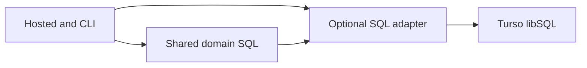
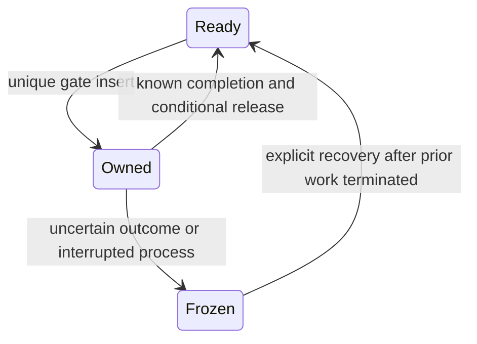

# Design: 外部DBを正本にした招待制ベータ

## Overview
既存の業務SQLと同期Engine APIを共有し、公開版だけTurso CloudのlibSQL engineへ直接接続する。通常buildはrusqliteを直接使い、保存形式・SQL経路・測定条件を変えない。新しいRust製Turso engineとローカル複製は採らない。

## Boundary Commitments
- This Spec Owns: optional SQL adapter、coreのremote保存方針、hostedの認証/組織対応/永続排他、remote CLIと論理保存・復旧。
- Out of Boundary: Worker/Container設定・secret登録・公開URLはcloudflare-hosting。業務仕様と画面の新機能は既存仕様。
- Allowed Dependencies: app→core→db、import→core。dbは業務・HTTP・認証を知らない。defaultではcore/appの`sql`はrusqliteのaliasである。
- Revalidation Triggers: adapter型・エラー・CLI・DB識別・排他・復旧形式が変わればcloudflare-hostingの起動/再作成/公開ゲートを再検証する。

## Architecture

既存のファイルDBは別buildの同じ業務コードを使う。cloud featureは`meibo-db`、公式`libsql-hrana =0.10.0`の型、`reqwest =0.13.5`、共有Tokio runtimeを使う。reqwestはdefault-features=false、json/native-tls-no-alpn。旧libsql SDKは採用しない。この組合せはRust1.88でcompileし、online cargo-denyのadvisories/licenses/sourcesを通過した。

## File Structure Plan
| Component | 新規/変更するファイルと責務 |
|---|---|
| SQL adapter | `crates/db/Cargo.toml`、`src/{lib,params,row,statement,transaction,remote}.rs`、`tests/remote.rs`: 型・同期bridge・接続状態・実sqld試験 |
| Core policy | `crates/core/{Cargo.toml,src/lib.rs,src/engine.rs,src/schema.rs}`、新規`src/schema/remote.rs`: alias、remote create/open/write/識別。既存domain moduleのSQL importをaliasへ変更 |
| Core maintenance | `crates/core/src/{erase.rs,engine.rs}`と新規`src/remote_snapshot.rs`: remoteの論理行の出入と整合性。checkpoint/fs/compactの分岐 |
| Hosted store | `crates/app/{Cargo.toml,src/main.rs,src/hosted.rs,src/hosted/{store,auth,http,cli}.rs}`、新規`hosted/remote.rs`: 接続設定、登録対応、remote CLI、既存認証の共有 |
| Operation gate | 新規`crates/app/src/hosted/remote_gate.rs`: 非失効の共有排他、所有照合、明示復旧、状態不明の通知 |
| Backup/restore | 新規`crates/app/src/hosted/remote_backup.rs`: 目録・全組織の保存/復旧。既存backup.rsの手元版は維持 |
| Integration | `Cargo.lock`、`crates/app/tests/remote_hosted.rs`、`crates/db/tests/remote.rs`、必要なxtask検査入口: 合成の実sqld/fault proxy/既存回帰。foundationで`crates/core/tests/process/no_network.rs`の対象を通常app/coreの実graphへ直す |

## Components and Interfaces
### 1. SQL adapter
`Connection`はlocal/remoteの識別、同期runtimeと接続状態を持つ。`RemoteOptions`はURL/token/要求期限/応答上限を持ち、Debugは秘密を伏せる。本番はHTTPS/libsqlの許可形式だけ、HTTPは明示したloopback試験だけ許す。
`Connection::{execute,execute_batch,query_row,prepare,prepare_cached,transaction,unchecked_transaction,transaction_with_behavior,last_insert_rowid,is_autocommit}`、`Statement::{execute,query,query_map,exists}`、`Rows::next`、`Row::get<I,T>`、`Transaction::{commit,rollback}`とConnectionへのDerefを提供する。params!/params_from_iter、OptionalExtension、Result/Error/ErrorCode、Value/ToSql/FromSqlの既存使用範囲を維持する。
cloud buildも従来の手元CLIをcompileできるよう、local Connectionのopen/open_with_flags/path/busy_timeout/pragma_update/pragma_query_value/backupとOpenFlags/TransactionBehavior/MAIN_DBをforwardする。remote側では明示Unsupportedを返し、Core policyが呼ばない。無関係なrusqlite全APIは再実装しない。
`Value`はNull/Integer(i64)/Real(f64)/Text/Blobを区別し、整数をf64経由で変換しない。Row変換失敗とSQL制約/重複/not-foundを既存の業務エラーへ結び付ける。last_insert_rowidは書込み応答に紐付く値であり、別接続で問い合わせない。
transportは公式`proto::{PipelineReqBody,PipelineRespBody,StreamRequest,StreamResponse}`で`POST /v2/pipeline`を処理する。BEGIN以降はTransactionと元Connectionで同じbatonを更新・共有し、wrapperのtransaction操作で状態を遷移する。v2にないGetAutocommitを送らない。lastrowidはExecute応答から保持する。execute_batchはtrustedなSQL全文をSequenceで送り、trigger内のセミコロンを分割しない。HTTP経由で任意SQLを受け付けない。
commit/rollback/Dropは正確に一度、Drop rollback失敗もpoisonする。transport失敗後の接続再使用・自動再送を禁止し、commit応答消失はOutcomeUnknownとする。応答件数・variant・batonを検証し、serverのbase_urlは設定済みoriginと一致し、userinfo/query/fragmentを持たないものだけ許す。不一致で別hostへ秘密を送らず接続をpoisonする。
HTTP1のみ、redirect禁止、retry禁止、TLS証明書/host検証とTLS1.2以上を明示する。期限は既定30秒/最大120秒、各応答のbody上限は既定16MiB/最大32MiB。成功・errorとも受信chunkを上限内と確認してからVecへ足し、JSON decode前に制限する。cap/timeout/不完全な応答でpoisonする。HTTP2と圧縮機能は有効化しない。
Rowsは上限内で受信した単一応答の行を反復し、無制限の全結果をbufferしない。長いscan/export/snapshotはcoreで500行以下のkeysetページへ分割する。requestごとの応答上限は累積DBサイズの上限ではない。全件整合は上位の排他で保証する。Linux buildにはpkg-config/libssl-dev、runtimeにはlibssl3/CAが必要で、配備側が用意する。

### 2. Core policy
`Engine::{create_remote(endpoint,identity,origin,options),open_remote(endpoint,identity,options)}`をcloud限定で追加する。`RemoteIdentity`はdatabase_idと種別を持ち、HTTP要求から作らない。通常のcreate/open/migrate/公開APIは変えない。
createは空の新DBだけを初期化する。`meta`へremote format marker、schema_version、database_id、data_originと既存拡張版を記録する。openは全markerと期待ID/版/種別を照合し、未知・欠落・未来版を拒否する。remoteはapplication_id/user_versionを書かず、手元版は従来PRAGMAを維持する。
remote writeは同じBEGIN IMMEDIATEで業務処理を確定する。fs容量見積り・WAL・checkpointを呼ばず、外部DBの容量/制約エラーを失敗として返す。読み取りsnapshotも同streamで維持する。既存SQLのFTS5 trigram・生成列・trigger・件数更新は共有する。
論理消去/tombstoneは共有する。手元専用compact/WAL/ファイルbackupはremoteで明示Unsupportedとし、物理消去を保証しない。remote保存/復旧は以下の別入口を使う。全件verify/CSVと保存のscanはbounded keysetへ分け、途中を黙って省略しない。

### 3. Hosted storeとOperation gate
`hosted-remote CONFIG COMMAND`を追加し、既存hostedのinit/tenant-add/user-add/password-set/user-disable/member-set/revoke/audit/backup/restore/serve/sync-ntaと同じ許可・password-stdin規則を適用する。外部DB作成やプラン変更は行わない。追加の`gate-status`と`gate-recover OWNER --prior-work-terminated`は運用専用である。
CONFIGはversion、controlのURL/token環境変数名、tenant slugごとの環境変数名を持つ。実URL/tokenを保存形式や目録へ埋めない。重複slug/接続先、未設定、1000組織超を拒否する。control内の登録`remote_tenants(slug,database_id)`と各DB markerを照合し、同じDBを2組織へ割り当てない。
`remote_gate(slot INTEGER PRIMARY KEY CHECK(slot=1), owner BLOB NOT NULL, at INTEGER NOT NULL, operation TEXT NOT NULL)`をcontrolに置く。ownerはOS乱数32bytesのdigestで、唯一slotへのINSERTの成功応答だけが取得成功を意味する。既存行があれば503。TTLや自動takeoverは無い。
HTTP/管理/保存/復旧はすべて同じgateを取得する。既知の正常/業務失敗が完了したときだけ`DELETE ... WHERE slot=1 AND owner=?`で解除する。GateGuardのDropは解除しない。panic、切断、結果不明、所有不一致は取得状態を残す。poisonを返り値で失わないよう、hostedは使用した全接続の状態を終端で確認する。
gate取得自体の応答消失も失敗として取得を試し直さない。再起動は占有gateを解除しない。operatorは以前のprocess/containerと進行中要求の終了を確認し、gate-statusのowner/operationを照合して明示復旧する。期限や古さだけで解除せず、復旧を監査する。
password/hash/session/期限/role/CSRF/contextは既存実装を共有する。controlを含むremote transport失敗はgeneric errorへ隠したまま成功扱いにせず、503/outcome_unknownと「処理結果を確認できません。再送せず管理者へ連絡してください。」を返す。利用者に接続先やSQLを出さない。

### 4. Backup/restoreとData Models
保存はgate取得後、登録組織一覧とdatabase_idを固定する。提供者の古いsnapshotに依存せず、許可したschema/table/column定義に従うkeysetページを読み、型付き行を新規directoryへ逐次保存する。schema SQLを保存物から実行しない。
形式version=1、manifestはservice識別/tenant slug/data_origin/schema版/table別行数/SHA-256と相対ファイル名だけを持つ。行は列順付きNull/Integerの10進文字列/RealのIEEE754 bit文字列/Text/Blobのbase64で表す。各行1MiB以下・page500行以下・buffer32MiB以下、manifest1MiB/組織1000以下。秘密、sessions、remote_gateは除外する。
対象はmeta、companies（生成has_phoneを除く）、contacts、activities、lists、list_members、counts、crm_work_items、crm_opportunities、custom_field_definitions、custom_field_values、erased_corporate_numbersと、controlのmeta/users/tenants/memberships/audit/login_attempts/remote_tenants。erase_gateは空を確認し、FTS shadow tableは保存せず復旧後にrebuildする。
既知AUTOINCREMENT表のsqlite_sequence high-waterも保存する。現在はcustom_field_definitionsが対象で、値が非負i64かつ現存idの最大値以上であることを検証し、行の投入後に復元する。削除した最大field IDが復旧後に再利用されないことを試験する。未知表のsequenceは拒否する。
復旧はsource gate下で全hash/型/件数/相対pathとsymlink不使用を先に検証し、sourceと異なる明示target mappingの全DBが空であることを確認する。新しいcontrol markerをrestoringにして既知schemaと行を投入し、tenantの索引/FTS/外部キー/件数/foldを検証する。任意SQL、保存物内URL、既存targetは拒否する。
成功時だけcontrolをreadyへ変更し、instanceとdatabase_id/登録対応をtarget用に再発行、sessions/gateを空にする。途中失敗はrestoringのまま、sourceを変更せず、対象の削除や既存DBへの切替はしない。restoringはserve不可。復旧先gateが空でもready前は使えない。

## System Flows

## Requirements Traceability
| Requirements | Components and validation |
|---|---|
| 1.1, 1.2, 1.3, 1.4 | SQL alias、Core policy、Hosted mapping、再起動 |
| 2.1, 2.2, 2.3, 2.4, 2.5, 2.6 | SQL adapter、同stream transaction、Core policy、poisonとgate、fault proxy |
| 3.1, 3.2, 3.3, 3.4, 3.5 | Hosted store、Operation gate、owner一致/失効/2組織の実sqld試験 |
| 4.1, 4.2, 4.3, 4.4, 4.5 | Backup/restore、typed rows、manifest、空target/改変/中断の実試験 |
| 5.1, 5.2, 5.3, 5.4 | Core maintenance、全件verify/CSV、Integration、既存品質門 |

## Error Handling and Testing Strategy
通常buildの既存check-all/MSRV/性能経路を保つ。実sqld/fault試験はintegration-tests featureを明示した別入口/CIで実行し、runtime単体試験にsqldを要求しない。default-localの通信禁止bansを保つgraphとcloud用policyを分け、双方でadvisory/license/source検査を続ける。旧SDK/Hyper0.14をtest helperからも除く。
defaultの依存検査はapp/coreのnormal/build cargo treeを使い、default featuresを有効なまま調べる。optional依存が載るlockfile全体を通常版のlink graphと混同せず、禁止package一覧とdeny.tomlの検査は維持する。この試験修正と全workspace回帰はfoundation完了条件に含め、policy分離を待たない。
cloud buildは実sqldの合成DBで同一の業務契約、500行境界のCSV、2文字/3文字検索、取消・消去・独自項目、2組織3権限、session変更とブラウザcontextを確認する。接続秘密の漏れ、timeout/サイズ上限、SQL失敗rollback、commit後の応答を落とすproxy、process停止後gate保持・owner違いの解除拒否・明示復旧、保存→新DB一式復旧→再ログイン→全表照合を試験する。本物のCloudflareとTursoの確認はcloudflare-hostingで別に記録する。
